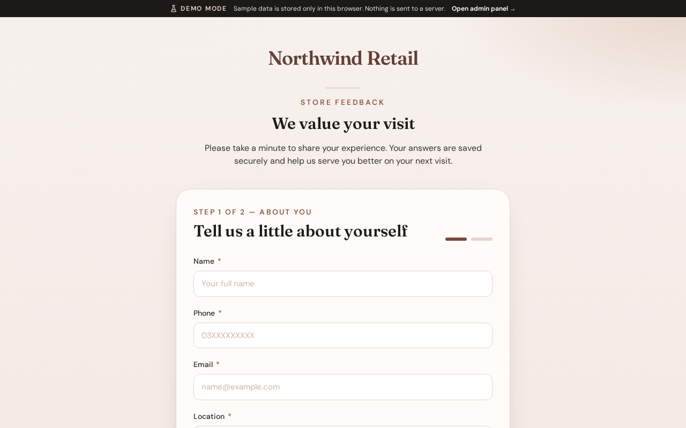

# Customer feedback form

**Version:** 1.0.0  
**Route:** `/`  
**Who can access:** Anyone (public)

## What this page does

Collects store-visit feedback from customers in a short multi-step form. Submitted responses appear in the admin dashboard and entries list.

## Layout at a glance

- Brand header (store name or logo)
- Step progress indicator
- Form fields for personal details, then visit feedback
- Continue / Back / Submit actions

## Steps

1. Open the public form at `/`.
2. Complete **About you**: full name, phone, email, location, gender, and age group.
3. Select **Continue**.
4. Complete **Visit feedback**: date of visit, challenges (if any), purchase categories, overall satisfaction (stars), and optional notes.
5. Select **Submit**. A confirmation message appears when the response is saved.

## Fields

| Area | Fields |
|------|--------|
| About you | Full name, phone, email, location, gender, age group |
| Visit feedback | Date of visit, challenges, purchase categories, overall satisfaction, notes |

Required fields are marked. Invalid fields highlight before you can continue.

## Errors & edge cases

- Missing required fields block progress until corrected.
- If submission fails, an error message appears; you can retry without losing entered data where possible.

## Related

- [Admin login](./02-login.md)
- [Dashboard](./03-dashboard.md)
