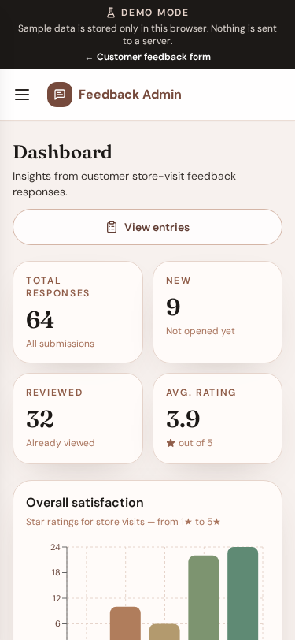

# Dashboard

**Version:** 1.0.0  
**Route:** `/admin`  
**Who can access:** Signed-in admin users

## What this page does

Summarizes feedback responses with totals and charts so teams can see trends at a glance.

## Layout at a glance

- Summary cards: Total responses, New, Reviewed, Avg. rating
- Charts: Overall satisfaction, Gender, Age group, Visit challenges, Purchase categories
- Link to **View entries**

## Steps

1. Sign in and open **Dashboard** (home of `/admin`).
2. Review summary cards. Select **Total responses**, **New**, or **Reviewed** to open the entries list with the matching status filter.
3. Scroll charts for satisfaction, demographics, challenges, and categories.
4. Select **View entries** to browse individual submissions.

## Charts

| Chart | Insight |
|-------|---------|
| Overall satisfaction | Star ratings from 1★ to 5★ |
| Gender | How respondents identify |
| Age group | Age brackets in the responses |
| Visit challenges | Selected challenge options |
| Purchase categories | Categories customers usually buy |

## Errors & edge cases

- If no responses exist yet, charts show an empty state.
- Average rating shows an em dash when no ratings are available.

## Related

- [Feedback entries](./05-entries.md)
- [Navigation](./04-navigation.md)
