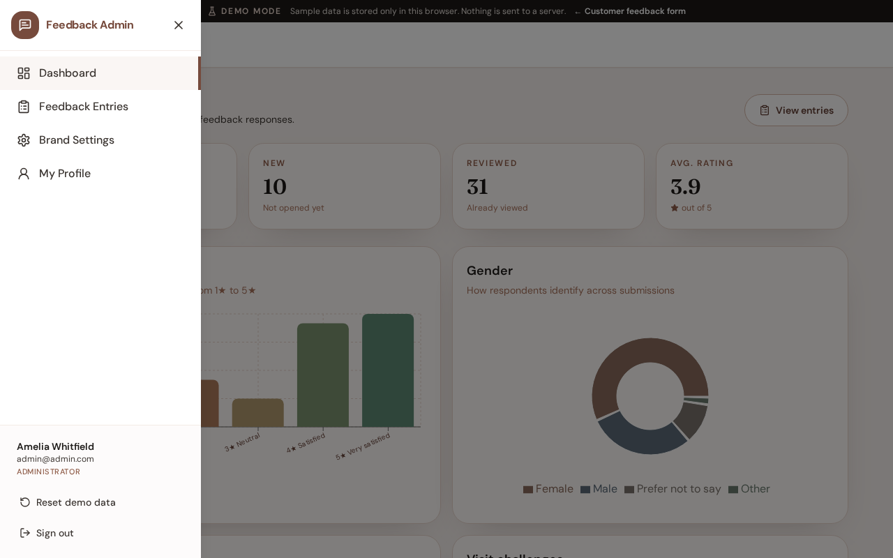
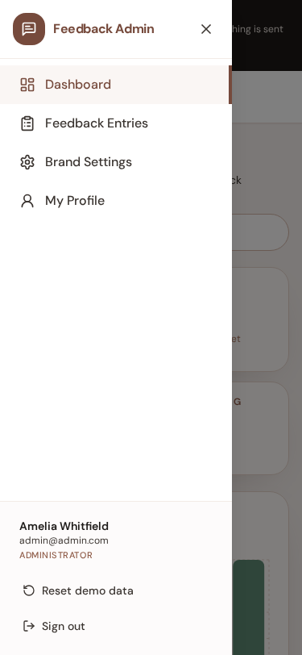

# Admin navigation

**Version:** 1.0.0  
**Route:** All `/admin/*` panel pages  
**Who can access:** Signed-in admin users

## What this page does

The burger menu opens a left drawer with links to every admin section.

## Layout at a glance

- Header with Feedback Admin branding
- Links: Dashboard, Feedback Entries, Brand Settings, My Profile
- Sign out (and Reset demo data in Demo Mode)

## Steps

1. Select the **Open menu** button in the top bar.
2. Choose a destination in the drawer.
3. Select **Close menu** or the backdrop to dismiss the drawer.
4. Use **Sign out** when finished.

## Menu destinations

| Item | Route |
|------|-------|
| Dashboard | `/admin` |
| Feedback Entries | `/admin/entries` |
| Brand Settings | `/admin/settings` |
| My Profile | `/admin/profile` |

## Related

- [Dashboard](./03-dashboard.md)
- [Brand settings](./07-brand-settings.md)
