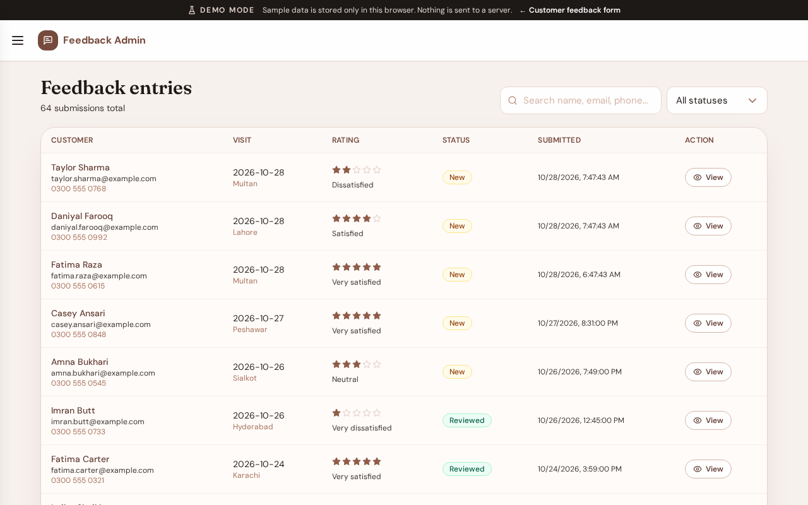
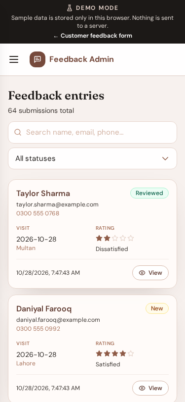

# Feedback entries

**Version:** 1.0.0  
**Route:** `/admin/entries`  
**Who can access:** Signed-in admin users

## What this page does

Lists customer submissions with search, status filter, and pagination. Desktop shows a table; mobile shows cards.

## Layout at a glance

- Search field and status filter
- Entry rows/cards (name, contact, location, status, rating, date)
- Pagination controls

## Steps

1. Open **Feedback Entries** from the menu.
2. Optionally type in **Search name, email, phone…**.
3. Optionally filter by **All statuses**, **New**, **Reviewed**, or **Archived**.
4. Select a row or **View** to open the [entry detail](./06-entry-detail.md).
5. Use **Prev** / **Next** to change pages.

## Status filter from the dashboard

Opening entries from a dashboard summary card applies the matching status (`new` or `reviewed`) automatically via the URL.

## Errors & edge cases

- Empty results show a calm empty state.
- Network or load errors appear as a banner above the list.

## Related

- [Entry detail](./06-entry-detail.md)
- [Dashboard](./03-dashboard.md)
