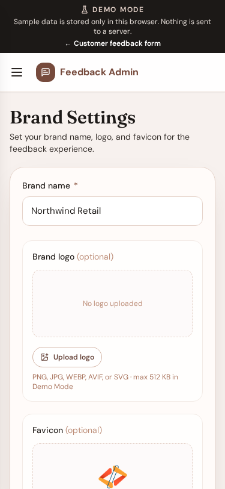

# Brand settings

**Version:** 1.0.0  
**Route:** `/admin/settings`  
**Who can access:** Signed-in admin users with edit permission

## What this page does

Configures the store name and optional logo/favicon shown on the public form and browser tab.

## Layout at a glance

- Store / brand name (required)
- Logo upload (optional)
- Favicon upload (optional)
- Save action

## Steps

1. Open **Brand Settings** from the menu.
2. Enter the **brand name**.
3. Optionally upload a logo and/or favicon image.
4. Save changes.
5. Open the public form to confirm branding appears as expected.

## Notes

- Brand name is required.
- Logo and favicon are optional; the form falls back to the brand name (and a default icon when needed).

## Errors & edge cases

- Oversized or unsupported files are rejected with a clear message.
- Viewer accounts may see settings as read-only in Demo Mode.

## Related

- [Customer feedback form](./01-customer-form.md)
- [My Profile](./08-profile.md)
