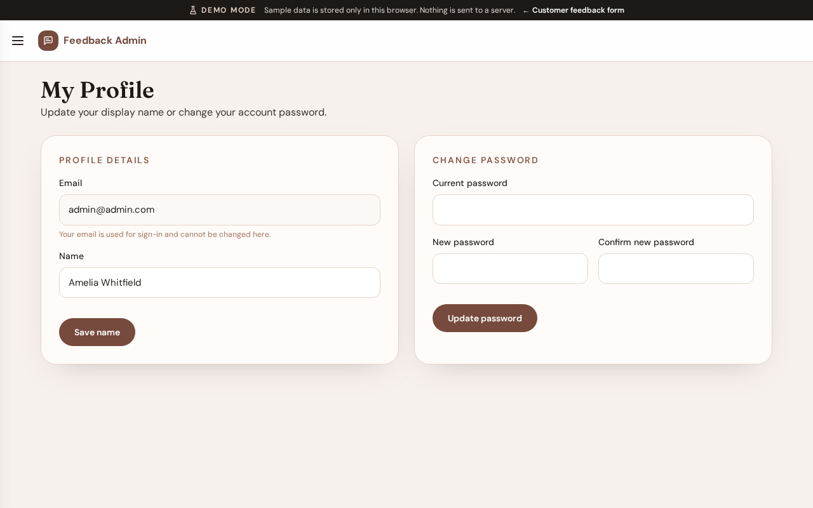

# My Profile

**Version:** 1.0.0  
**Route:** `/admin/profile`  
**Who can access:** Signed-in admin users

## What this page does

Lets the signed-in user update display name and password for their admin account.

## Layout at a glance

- Display name
- Email (usually read-only)
- Password change fields
- Save actions

## Steps

1. Open **My Profile** from the menu.
2. Update your display name if needed and save.
3. To change password, enter the current and new password fields, then save.
4. Sign out and sign back in if you need to confirm the new password.

## Errors & edge cases

- Password mismatch or weak validation messages appear inline.
- In Demo Mode, password changes validate but demo account passwords remain usable for capture and training.

## Related

- [Admin login](./02-login.md)
- [Brand settings](./07-brand-settings.md)
