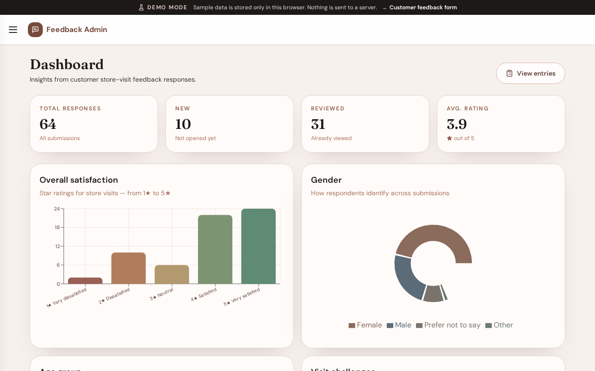
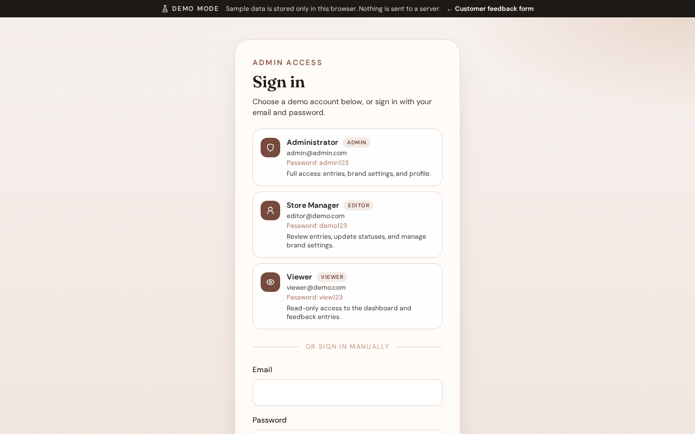
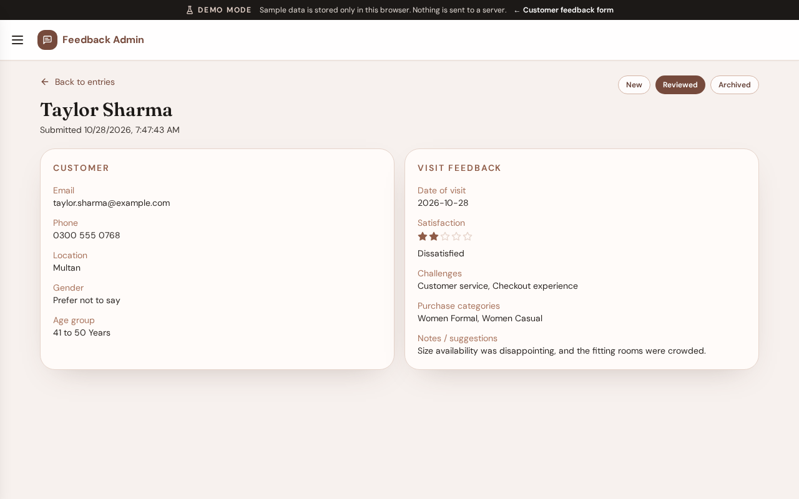
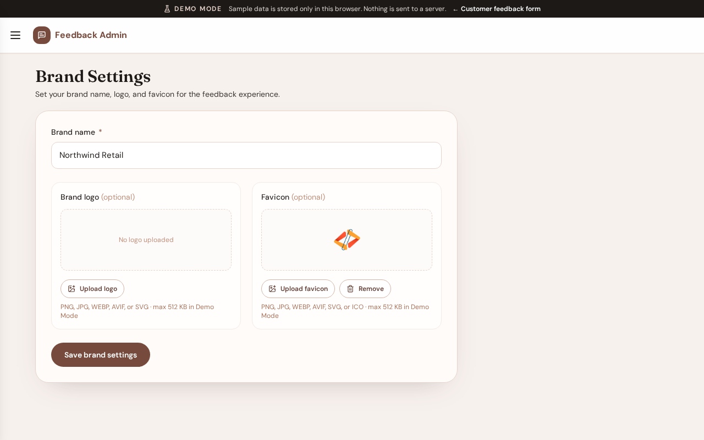

# Store Feedback System

Collect store-visit feedback from customers and review response trends in a professional admin dashboard.



## Overview

Store Feedback System is built for retail teams that want a clean customer form and a focused admin experience. Customers submit visit feedback in a short multi-step flow. Staff sign in to review responses, track status, and explore charts across satisfaction, demographics, challenges, and purchase categories.

Brand name, logo, and favicon are configurable so the form can match the store without hardcoding a client identity in the product.

## Features

- Public multi-step customer feedback form
- Admin dashboard with summary cards and response charts
- Feedback entries list with search, status filters, and detail views
- Brand settings for store name, logo, and favicon
- Admin profile name and password controls
- Offline Demo Mode for portfolio review (no live backend required)

## Screenshots



*Admin login with demo account cards (Demo Mode)*


*Feedback entries list*



*Single feedback entry*



*Brand settings*

## Demo

- **Local Demo Mode:** see [`demo-mode/README.md`](demo-mode/README.md)  
  ```bash
  cd demo-mode && npm install && npm run dev
  ```
- **Live demo:** deploy pending — set `live_demo_url` in `demo-mode/demo.json` after you host Demo Mode as its own project (Root Directory = `demo-mode`).
- Demo logins are shown as account cards on the Demo Mode login screen.

## Documentation

Full guides and screenshots live under [`Documentation/`](Documentation/index.md).

## Tech stack

| Layer | Choice |
|-------|--------|
| App | Next.js 14 (App Router), React, TypeScript |
| Styles | Tailwind CSS |
| Charts | Recharts |
| Production data | Supabase (Postgres + Auth) |
| Demo Mode | Standalone Next.js app with localStorage |

## Getting started (production app)

1. Copy `.env.example` → `.env.local` and fill the required keys.
2. In Supabase SQL editor, run `database/schema.sql`, then brand patches if needed, then **`database/rpc.sql`** (admin dashboard / list / detail RPCs — required for free-tier-friendly reads).
3. Install and run:

```bash
npm install
npm run dev
```

- Customer form: http://localhost:3000  
- Admin panel: http://localhost:3000/admin  

Admin sign-in uses Supabase Auth users. Never commit real secrets.

## Version

**1.0.0** (2026-10-28) — see [`Documentation/APP-VERSION.md`](Documentation/APP-VERSION.md) and [`Documentation/CHANGELOG.md`](Documentation/CHANGELOG.md).

## Notes for maintainers

`demo-mode/` is excluded from the main product production build. Deploy Demo Mode separately. Reference folders such as `Courier-Dashboard/` and `Personal Notedbook/` are local only.
